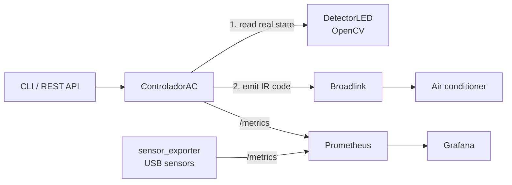

# CPD Remote Climate Control

Remote monitoring and control of a data center air conditioner, built as a Bachelor's thesis (grade 9.7/10) at Universidad Carlos III de Madrid.

The air conditioner only has an infrared remote, so the system does three things:

- **Controls it** by emitting the remote's IR codes through a Broadlink device, from a REST API or a command line.
- **Checks it** by reading the unit's indicator LED with a camera and computer vision, so a command is never trusted blindly.
- **Monitors it** with Prometheus and Grafana: AC state, target temperature, cold and hot aisle temperatures read from USB sensors, and IR command activity.


## How it works



Every command follows the same flow: read the camera to know the real state, decide whether an IR code is needed (for example, powering on a unit that is already on is skipped), emit it with retries, and record the result. The last known state is saved to disk with a flag telling whether the camera confirmed it.

**LED detection.** A tiny region of interest around the LED is analysed with four independent criteria, and the LED counts as on when at least two agree: pure red in HSV, magenta/cyan color drift, saturated white (overexposed LED), and a grayscale brightness fallback. The region can be recalibrated at runtime through the API.

**Temperature control.** The IR codes are stateful (`TEMP_22` means "set 22 °C", not "one degree down"), so a temperature can be sent directly or stepped through the intermediate codes. The valid range (20-23 °C) is limited to the codes captured from the physical remote.

**Room temperature.** `sensor_exporter.py` reads two USB temperature sensors over a serial port (cold and hot aisle) and serves them over HTTP and as Prometheus metrics. A mock backend allows development without sensors.

## Stack

Python · FastAPI · OpenCV · python-broadlink · prometheus-client · Prometheus · Grafana · Docker/Podman Compose

## Project structure

```
api/routes.py            REST API with integrated Prometheus metrics
modules/
  controlador_ac.py      orchestrator: camera, IR emission and state
  detector_led.py        LED state detection (computer vision)
  broadlink_client.py    IR emission and learning, auto-discovery
  estado_ac.py           AC state model and persistence
  sensor_temperatura.py  room temperature client (HTTP or mock)
  metricas.py            Prometheus metrics registry
sensor_exporter.py       USB temperature sensors -> HTTP / Prometheus
main_cli.py              command line interface
config/settings.py       all configuration constants
config/codigos_ac.json   learned IR codes
monitoring/              Prometheus config and Grafana provisioning + dashboard
docker-compose.yml       Prometheus + Grafana
```

## Getting started

```bash
# 1. Dependencies
pip install -r requirements.txt

# 2. Monitoring stack (Docker or Podman Compose)
cp .env.example .env        # set GRAFANA_ADMIN_PASSWORD
docker compose up -d        # Prometheus :9090, Grafana :3000

# 3. API
uvicorn api.routes:app --host 0.0.0.0 --port 8000

# 4. Temperature exporter, on the machine with the USB sensors
pip install -r requirements-sensor.txt
python sensor_exporter.py   # :8001
```

On first use the Broadlink device is discovered on the local network (`POST /broadlink/discover`) and its address is saved to `config/broadlink_config.json`, which is git-ignored. `config/broadlink_config.example.json` shows the format. The command line works without the API: `python main_cli.py --help` (`encender`, `apagar`, `temperatura 22`, `estado`, `validar`, `demo`, ...). It also accepts `--imagen <file>` to run the LED detection on a still image.

### Configuration

| Setting | Where | Purpose |
|---|---|---|
| `GRAFANA_ADMIN_PASSWORD` | `.env` | Grafana admin password (required) |
| `SENSOR_HTTP_URL` | environment | Temperature exporter URL (default `http://localhost:8001/temperatura`) |
| `COLD_AISLE_SN`, `HOT_AISLE_SN` | environment | USB sensor serial numbers, to tell the two sensors apart |
| `ROI_LED`, `UMBRAL_BRILLO`, `CAMARA_INDEX`, `TEMP_MIN/MAX`... | `config/settings.py` | Camera, detection and control parameters |

## API

| Method | Endpoint | Description |
|---|---|---|
| GET | `/metrics` | Prometheus metrics |
| GET | `/health` | Health check |
| GET | `/estado` | Current AC state |
| POST | `/encender`, `/apagar` | Power on / off |
| POST | `/temperatura` | Set temperature (direct or stepped) |
| POST | `/modo`, `/fan` | Change mode / fan speed |
| POST | `/validar` | Synchronise the state with the camera |
| GET, POST | `/camara/roi` | Read or redefine the LED region |
| POST | `/camara/debug` | Save a debug capture |
| GET | `/sensor` | Latest room temperature reading |
| POST | `/broadlink/discover` | Discover the IR device |

Metrics: `ac_encendido`, `ac_temperatura_objetivo_celsius`, `ac_led_detectado`, `ac_temperatura_ambiente_celsius`, `ac_comandos_total`, and `ac_sala_temperatura_celsius{zone}` from the sensor exporter. The Grafana dashboard "Control AC" shows the state, target temperature, both aisle temperatures, LED detection and IR command rate.

## Security notes

- The API has **no authentication** and listens on `0.0.0.0`. Run it only on an isolated network or behind a reverse proxy with authentication.
- Set a strong Grafana password and never commit `.env` or `config/broadlink_config.json`.

## Notes

The code comments and the API documentation are in Spanish. The sensor protocol in `sensor_exporter.py` follows the original script used with the cluster's sensors.
